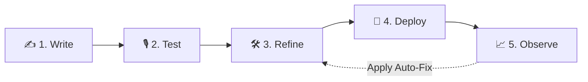
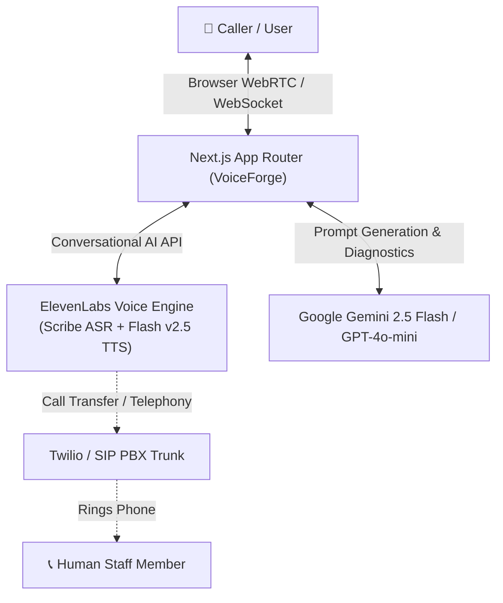

# VoiceForge 🎙️
### Autonomous Bilingual Voice AI Agent Studio for Businesses & Clinics

[](https://nextjs.org/)
[](https://www.typescriptlang.org/)
[](https://elevenlabs.io/)
[](https://ai.google.dev/)
[](https://tailwindcss.com/)
[](https://playwright.dev/)

VoiceForge is a modern, no-code voice AI studio that allows non-technical business owners, clinics, and enterprises to build, test, refine, deploy, and observe conversational Voice AI assistants in minutes. 

Equipped with **real-time bi-directional audio streaming**, **instant bilingual code-switching (English ↔ Hindi)**, **native human call transfer**, and **closed-loop self-healing prompts**, VoiceForge bridges the gap between complex voice engineering and everyday business operations.

---

## 🌟 The Problem & The Solution

* **The Problem**: 
  Over 62% of incoming calls to service businesses (dental clinics, agencies, schools, consultancies) go unanswered after-hours or during peak rushes, causing lost bookings and frustrated clients. Existing voice bot solutions either require complex developer setup, hallucinate prices and policies, or speak unnatural robotic accents that alienate regional and multilingual callers.
* **The VoiceForge Solution**: 
  A streamlined 5-step studio where any owner can paste their website URL or write a 2-sentence description, test their live AI receptionist in under 60 seconds with authentic native accents, deploy a public link or phone line, and automatically fix errors found in flagged transcripts with one click.

---

## 🚀 The 5-Step Agent Lifecycle



### 1. ✍️ Write (`/write`) — Knowledge & Persona Studio
- **Plain Language & Website Ingestion**: Describe your business or input a website URL. Our SSRF-safe scraper extracts verified business facts (operating hours, services, doctors/staff, and pricing).
- **Zero-Hallucination Guardrails**: Prompts enforce that the agent strictly adheres to verified facts and never invents medical advice, prices, or policies.
- **Bilingual Opening Selection**: Set the greeting in **English** or **Hindi** with paired native voice recommendations (e.g. *Ritu Rathore* or *Sandeep* for Hindi; *Rachel* for English).
- **Mandatory AI Disclosure**: Enforces ethical compliance by requiring every assistant to clearly disclose its AI identity on the very first turn.

### 2. 🎙️ Test (`/test`) — Real-Time Conversational Testing
- **Sub-Second Bi-Directional Audio**: Powered by ElevenLabs WebSockets (`scribe_realtime` ASR + `eleven_flash_v2_5` TTS) for ultra-low latency (~150ms).
- **Dynamic Mid-Call Code-Switching**: Start speaking in English, then switch mid-sentence to Hindi or Hinglish. The agent dynamically detects language, triggers the `language_detection` tool, and switches to native Indian Hindi pronunciation and vocabulary on that exact turn.
- **Hardware Echo Cancellation & Clean Mic Pipeline**: Clean browser AudioWorklet pipeline with hardware echo cancellation and noise suppression, preventing false interruptions.
- **Live Tool Visibility**: Real-time event log tracking tool requests (`transfer_to_number`, `language_detection`, appointment booking) and latency metrics.

### 3. 🛠️ Refine (`/refine`) — Natural Language Tuning & Sync
- **Conversational Tuning**: Type natural feedback (e.g., *"Make the tone more reassuring for patients with acute tooth pain"* or *"Add an emergency weekend helpline"*).
- **Visual Diff Inspector**: Inspect exact field-by-field modifications before applying.
- **Round-Trip Live Sync**: Pushes updates directly to live ElevenLabs agents (`PATCH /v1/convai/agents/{agent_id}`) with verified rollback and undo support.

### 4. 🚀 Deploy (`/deploy`) — Public Channels & Telephony
- **Instant Public Web Link**: Shareable link (`/agent/[agentId]`) allowing customers to talk directly to your assistant from any mobile or desktop browser.
- **Native Telephony & Inbound Calling**: Ready for phone carriers via **Twilio** or **SIP Trunking**.
- **Live Call Transfer (`transfer_to_number`)**: Transcribes emergencies or human requests and hands off the live call to real staff phone numbers.

### 5. 📈 Observe (`/observe`) — Self-Healing Call Analytics
- **Call Explorer & Sentiment Analysis**: Review calls categorized by outcome (`Booked`, `Resolved`, `Flagged`, `Transferred to human`).
- **One-Click "Apply Fix"**: Analyzes flagged conversations (e.g., a customer asking about root canals or pricing not covered in knowledge), collects the owner's answer, and immediately updates the assistant's knowledge base.

---

## 🏗️ Architecture & Technology Stack



| Layer | Technologies Used | Purpose |
| :--- | :--- | :--- |
| **Frontend** | Next.js 14 (App Router), React 18, Tailwind CSS, Lucide Icons | Responsive UI, animated voice states, stepper navigation |
| **Voice Engine** | `@elevenlabs/react`, `@elevenlabs/client`, WebSocket ConvAI | Sub-second audio streaming, ASR, and neural TTS |
| **Reasoning LLM** | Google Gemini (`@google/genai`) & GPT-4o-mini | Fact extraction, conversational prompt design, and diagnostics |
| **Audio Processing** | Web Audio API, MediaDevices, Echo Cancellation | Crystal-clear microphone capture with barge-in protection |
| **Telephony Bridge**| ElevenLabs `transfer_to_number` tool, Twilio, SIP REFER | Seamless handoff from AI agent to live telephone numbers |
| **Quality & Tests** | Playwright, TypeScript (`tsc --noEmit`), ESLint | 15 comprehensive automated E2E tests across all workflows |

---

## 🇮🇳 Dynamic Bilingual Hindi & English Engine

VoiceForge was built from the ground up for multilingual communities:

* **Dual-Preset Voice Architecture**: The agent maintains active voice configurations for both **English** (e.g., *Rachel*) and **Indian Hindi** (e.g., *Ritu Rathore* or *Sandeep*).
* **Zero-Lag Code Switching**: When a caller speaks in English, the assistant uses an authentic English accent. If the caller asks a question in Hindi (*"नमस्ते, क्या आप मुझे अपॉइंटमेंट की जानकारी दे सकते हैं?"*), the assistant detects the language change on that turn and responds in natural Hindi.
* **Cultural Context & AI Disclosure**: Full bilingual greetings that strictly state AI identity (*"नमस्ते! मैं आपका AI सहायक हूँ..."*).

---

## ⚡ Quickstart & Installation

### Prerequisites
- **Node.js** v18+ or v20+
- **ElevenLabs API Key** ([elevenlabs.io](https://elevenlabs.io))
- **Google Gemini API Key** ([aistudio.google.com](https://aistudio.google.com))

### 1. Clone & Install
```bash
git clone https://github.com/RajSingh-webdev/VoiceForge.git
cd VoiceForge
npm install
```

### 2. Configure Environment Variables
Create a `.env.local` file in the root directory:
```env
# ElevenLabs Conversational AI Credentials
ELEVENLABS_API_KEY="your-elevenlabs-api-key"
ELEVENLABS_REAL_VOICE="true"
ELEVENLABS_REAL_AGENTS="true"

# Google Gemini Intelligence
GEMINI_API_KEY="your-google-gemini-api-key"

# (Optional) Pre-created ElevenLabs Agent ID
ELEVENLABS_AGENT_ID="your-agent-id"
```

### 3. Run Locally
```bash
npm run dev
```
Open **[http://localhost:3000/write](http://localhost:3000/write)** in your browser.

---

## 🧪 Comprehensive E2E Test Suite

VoiceForge includes a test suite covering the entire agent lifecycle:

```bash
# Run all Playwright E2E tests
npx playwright test
```

### Verified Test Coverage:
1. **Agent Identity & Multi-Assistant Separation**: Verifies Smile Dental and Spark Digital identities remain strictly isolated.
2. **Smoke Tests (Zero AI Quota)**: Validates navigation, stepper positioning, character limits, step reordering, and undo history.
3. **SSRF Security Protection**: Verifies `POST /api/site/extract` blocks loopback, internal IPs (`127.0.0.1`, `169.254.169.254`), and non-HTTP protocols.
4. **Voice & Language Presets**: Verifies selection persistence across reloads and live ElevenLabs syncing.
5. **Tool Normalization**: Validates appointment booking normalization and human call transfer mapping.

---

## 🔒 Security & Privacy

* **Zero Client Secret Exposure**: All API keys (`GEMINI_API_KEY`, `ELEVENLABS_API_KEY`) run strictly in server-side Next.js route handlers.
* **Server-Side Request Forgery (SSRF) Defense**: Website knowledge crawler blocks private IP ranges, cloud metadata endpoints (`169.254.169.254`), and non-HTTP protocols with HTTP 400.
* **Ethical AI Identity Disclosure**: AI identity declaration is non-bypassable in system prompts, public links, and greetings.

---

## 🗺️ Roadmap & Hackathon Vision

- [x] **Full 5-Stage Studio Lifecycle** (Write, Test, Refine, Deploy, Observe)
- [x] **Sub-second Real-time WebRTC/WebSocket Voice Engine**
- [x] **Bidirectional English ↔ Hindi Code-Switching with Native Accents**
- [x] **Native Live Call Transfer Integration (`transfer_to_number`)**
- [x] **Closed-Loop Self-Healing Prompts from Flagged Call Analytics**
- [ ] **WhatsApp & Telegram Outbound Audio Notifications**
- [ ] **Multi-Regional Indian Language Expansion** (Tamil, Telugu, Bengali, Marathi)
- [ ] **One-Click Native Twilio & Exotel Provisioning inside VoiceForge UI**

---

## 👥 Contributors & Acknowledgements

Built with ❤️ for the Hackathon by **[Raj Singh](https://github.com/RajSingh-webdev)**.  
Powered by **Google Gemini** and **ElevenLabs Conversational AI**.
